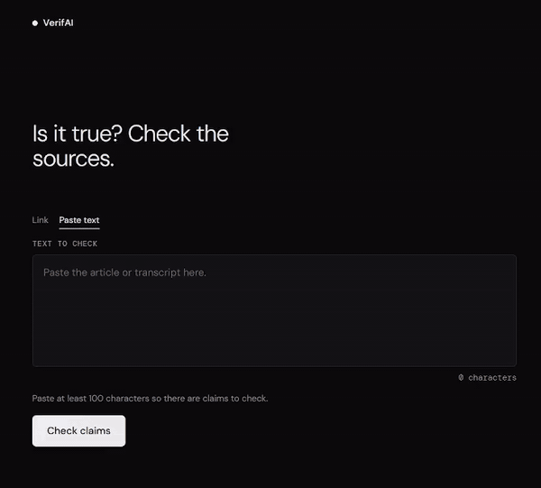
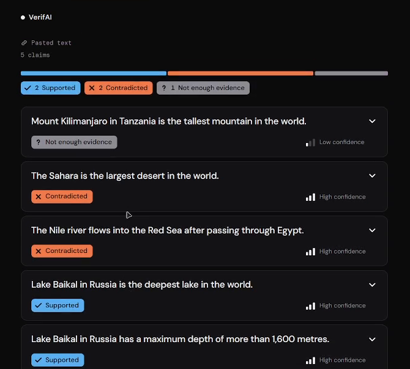
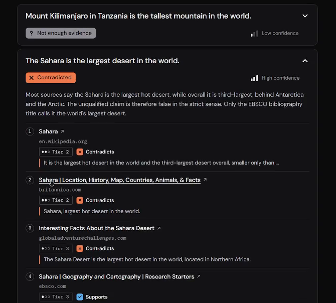
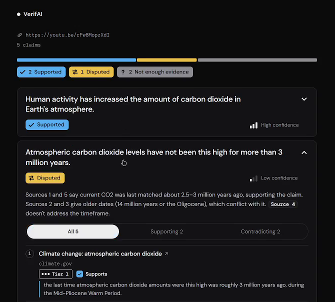
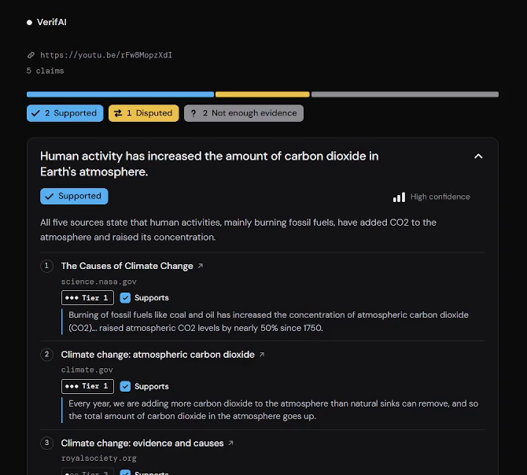
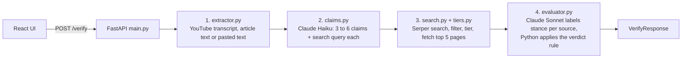

# VerifAI

Paste a YouTube or article link and get a sourced verdict on its key claims.

  

> **Status:** the public demo ran on free hosting for a short time and has been shut down to avoid API costs. Watch the demo below or run it yourself (see [Run it locally](#run-it-locally)).

## Demo



[Watch the full-quality video with music](docs/media/demo.mp4) (93 s). It shows a pasted text, two article links and a YouTube link.

| Results summary | Sources behind a verdict |
|---|---|
|  |  |

| Disputed verdict | YouTube link |
|---|---|
|  |  |

You paste a link. About 30 to 50 seconds later you get 3 to 6 checkable claims, each with a verdict (supported, contradicted, disputed, or not enough evidence), a confidence level, a short explanation and the sources behind it, ranked by trust tier.

## The problem

A video or an article can state a dozen facts in a few minutes. Checking them by hand means pausing, searching, opening tabs and judging which sites to trust. Most people do not do it.

VerifAI does the boring part. It pulls out the claims that can actually be checked, searches the web for evidence, has an LLM label what each source says, and applies a fixed, explainable rule to turn those labels into a verdict. Every verdict links to the sources behind it, so you can check the checker.

## How it works



1. **Extract.** A YouTube link gets its transcript. An article link goes through trafilatura, with newspaper4k as a fallback. Pasted text is used as is.
2. **Find claims.** Claude Haiku returns 3 to 6 self-contained, factual, web-checkable claims plus a search query for each, through tool use with a JSON schema validated by Pydantic. Text over about 12,000 words is chunked.
3. **Search.** Each claim is searched through Serper, in parallel. Results are filtered (the input's own domain, user-generated sites such as Reddit and Quora, duplicates), assigned a trust tier, and the top 5 pages are fetched (6 s timeout, about 2,000 characters around the claim's keywords).
4. **Evaluate.** One Claude Sonnet call per claim labels each source as `support`, `contradict` or `not_addressed`, with one evidence sentence. Claims run concurrently. Plain Python then computes the verdict.

Each stage can fail on its own. A failed claim is dropped and reported in the response's `errors` list instead of breaking the whole request. More detail is in [docs/architecture.md](docs/architecture.md).

## The verdict rule

The LLM never decides the verdict. It only labels what each source says. The verdict comes from a rule you can read in one screen of code (`backend/evaluator.py`).

| Tier | Which sources | Weight |
|---|---|---|
| 1 | Government (`.gov`, `.gov.xx`) and a short list of primary institutions | 3 |
| 2 | Universities (`.edu`, `.ac.xx`), Wikipedia, fact-checkers, major medical and science bodies | 2 |
| 3 | Everything else (including personal academic pages) | 1 |

| Verdict | Rule |
|---|---|
| **supported** | Supporting weight is at least 3, at least one Tier 1 or 2 source supports, and no Tier 1 or 2 source contradicts |
| **contradicted** | The mirror image of supported |
| **disputed** | Both sides have weight of at least 3, and both have a Tier 1 or 2 source |
| **insufficient_evidence** | Anything else |

Confidence comes from the winning side's total weight: **high** at 6 or more, **medium** at 4 to 5, **low** below 4. Disputed and insufficient results are always low. There are no percentages, because a number like "87%" would claim more precision than the method has.

**Why Tier 3 alone never decides.** Blogs and low-trust sites copy each other. Under an early version of the rule, four Tier 3 pages could reach "supported". Now one Tier 1 source is enough to support a claim, while one Tier 2 source needs corroboration, so a single source or a single mislabelled stance cannot decide a verdict on its own.

## Results

Honest numbers from my own testing. These are small samples, not benchmarks.

- **Tests:** 315 automated backend tests (no network or API calls needed).
- **Speed:** on 15 test URLs, 10 ran end to end in under 60 seconds, the slowest in 49.2 s. The other 5 failed at extraction (no captions, no English transcript, or sites that block scripts: AP, NYT, Reuters). They were not pipeline bugs.
- **Accuracy:** on a hand-labelled sample of 64 claims from 20 inputs (articles, videos and pasted texts), VerifAI's verdict matched my own label for 47 (73%). Most misses were "not enough evidence" on claims I judged true, because low-trust sources never decide a verdict alone.
- **False claims:** two test texts stated myths as fact without correction. All 5 false claims were marked **contradicted**, and none of the 7 true claims in those texts was.

| False claim in the test text | Verdict |
|---|---|
| Einstein failed maths | contradicted |
| Vikings wore horned helmets | contradicted |
| Kilimanjaro is the tallest mountain | contradicted |
| The Sahara is the largest desert | contradicted |
| The Nile flows into the Red Sea | contradicted |

The labels were made by one person, and two runs over the same inputs differ by a few points because search results and extracted claims vary. One high-trust page that the LLM misreads can still produce a wrong verdict. The full table, with the mistakes I found in my own labels, is in [docs/quality-table.md](docs/quality-table.md).

## Limitations

- **YouTube blocks cloud servers.** Transcripts work from a home PC but failed from the hosting provider's IP. The app shows a message asking you to paste the transcript instead. Articles and pasted text are not affected.
- **English YouTube videos only.** Videos with no speech or no English captions cannot be checked.
- **Some sites cannot be read.** AP, Reuters and paywalled sites (NYT) block scripted downloads. Paste the article text instead.
- **Many true claims end as "not enough evidence".** Most search results are Tier 3, and Tier 3 alone never decides.
- **Dated figures are searched badly.** A claim like "CO2 was 413.4 ppm in January 2020" often returns pages with current values.
- **Claim extraction is imperfect.** It sometimes leaves vague references ("the researchers"), rewrites a stated myth into its correction, and does not remove duplicate claims across chunks of very long text.
- **Stance labels come from one LLM call** with no second check.
- **Costs and limits.** Each check costs about $0.03 of API credit. There is no rate limit, no caching and no database by design.
- **Frontend has no automated tests.** It was checked by hand on desktop and a 390 px mobile layout.

The complete list is in [KNOWN_ISSUES.md](KNOWN_ISSUES.md).

## Run it locally

You need Python 3.11, Node 20 or newer, an [Anthropic API key](https://console.anthropic.com/) and a [Serper API key](https://serper.dev/).

**Backend** (PowerShell, from the repo root):

```powershell
py -3.11 -m venv backend\.venv
backend\.venv\Scripts\Activate.ps1
pip install -r backend\requirements.txt
copy backend\.env.example backend\.env   # then add your two keys
cd backend
uvicorn main:app --reload
```

The API docs open at http://127.0.0.1:8000/docs. `backend/.env` is gitignored, so never commit it.

**Frontend** (new terminal):

```powershell
cd frontend
npm install
$env:VITE_USE_FIXTURES="false"   # live mode, needs the backend running
npm run dev
```

Open http://localhost:5173. To try the UI without spending any API credit, set `VITE_USE_FIXTURES` to `true`: the UI then answers from saved responses. In fixture mode the URLs `https://example.com/disputed`, `/partial` and `/no-claims` show the other result states.

**Tests** (from the repo root):

```powershell
pytest
```

## Tech stack and project layout

| Part | Choice |
|---|---|
| Backend | Python 3.11, FastAPI, httpx, Pydantic |
| Extraction | youtube-transcript-api, trafilatura, newspaper4k |
| LLM | Claude Haiku (claim extraction), Claude Sonnet (stance labelling), via the Anthropic SDK |
| Search | Serper API |
| Frontend | React 19, Vite, Tailwind 4 (JavaScript, no UI library) |
| Hosting used for the demo | Render (backend), Vercel (frontend) |

```
backend/    main.py       FastAPI app, /verify, per-claim pipeline, CORS
            extractor.py  URL type detection, transcript and article text
            claims.py     claim extraction with Haiku, chunking
            search.py     Serper search, filtering, page fetch
            tiers.py      domain trust tiers
            evaluator.py  stance labelling with Sonnet, verdict and confidence rule
            models.py     Pydantic models (the response shape is frozen)
            tests/        unit tests and saved fixtures
frontend/   src/          React app (components, fixtures, API client)
docs/       architecture.md, quality-table.md, design/, deploy.md
```

## How others can improve it

Contributions are welcome. Open an issue before a big change so we can agree on the approach.

**Good first issues**
- Add trusted domains to the tier lists in `backend/tiers.py`, with a test and a reason why the domain deserves that tier.
- Add frontend tests (Vitest and React Testing Library) for the claim list, source list and disputed tabs.
- Show what "Tier 1, 2, 3" means on touch screens, where the hover tooltip does not work.
- Increase the tap target size of source links and tabs on mobile.

**Medium**
- Remove duplicate claims across chunks of long text, for example with a word-overlap check.
- Add a per-IP rate limit to `/verify`.
- Cache repeated claims in memory to cut API cost.
- Show the text of a failed claim instead of "Claim N could not be checked" (needs a change to the response shape).

**Bigger**
- Better search queries for dated or historical figures, so "413.4 ppm in January 2020" finds that figure instead of today's value.
- A second pass over stance labels to catch a misread page.
- A way to fetch YouTube transcripts from a cloud server (proxy or another transcript source).
- Support for non-English videos and articles.
- A benchmark: a labelled claim set that more than one person has reviewed, with a script that reports accuracy.

**Ground rules**
- Run `pytest` before opening a pull request. New backend functions need a docstring and tests.
- Keep the response shape in `backend/models.py` stable, or explain in the pull request why it has to change.
- The LLM only labels stance. The verdict stays plain, tested Python.
- Never commit `.env` files or API keys.

## Author

**G. Shashen** - first-year BSc (Hons) Artificial Intelligence student at APIIT Sri Lanka.
GitHub: [gShashen/verif-ai](https://github.com/gShashen/verif-ai)
